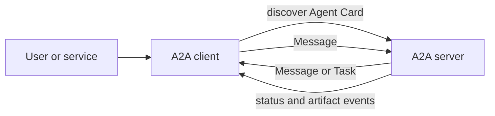
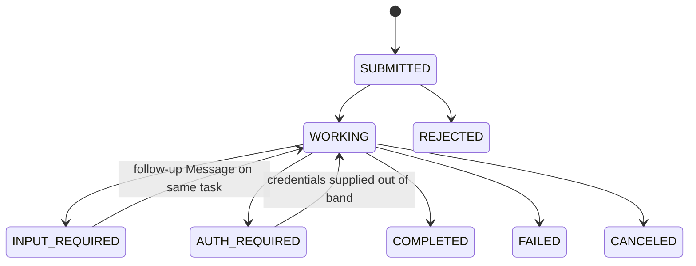

# A2A Protocol Cookbook

A runnable, concept-first cookbook for the [Agent2Agent (A2A) Protocol](https://a2a-protocol.org/latest/).
Every agent is deterministic: the examples teach the protocol without requiring an LLM, an API key,
or an internet connection.

The recipe inventory covers the primary A2A interaction patterns while keeping every scenario and
contract domain-neutral. The A2A v1.0 specification is the source of truth when a recipe and the
current protocol differ.

## Requirements

- Node.js 24 or newer
- npm

This repository uses native ES modules, async/await, Hapi, Zod, Vitest, and Prettier. There is no
TypeScript, transpiler, generated application code, LLM dependency, or required environment variable.

```bash
npm install
npm run cookbook -- 01
npm run cookbook -- all
npm test
```

## The A2A mental model



An A2A client acts for a user. It discovers an opaque remote agent from its Agent Card, selects a
compatible interface and skill, and sends a Message. The server can answer with a stateless Message or
create a stateful Task. Tasks carry status, history, and concrete outputs called Artifacts.

A2A standardizes the boundary between independent agents. It does not prescribe an agent's prompt,
model, memory, tools, or internal sub-agent framework. MCP commonly connects an agent to tools; A2A
connects independently deployed agents to one another.

### Core objects

| Object         | Purpose                                                                             |
| -------------- | ----------------------------------------------------------------------------------- |
| Agent Card     | Identity, interfaces, capabilities, skills, media modes, and security requirements. |
| Message        | One communication turn with a role and one or more Parts.                           |
| Part           | Text, structured data, inline bytes, or a URL reference.                            |
| Task           | A server-created, stateful unit of work with an immutable terminal result.          |
| Artifact       | A durable task output composed of Parts.                                            |
| StreamResponse | One streamed or pushed Task, Message, status update, or artifact update.            |

In JavaScript SDK memory, a text Part uses
`{ content: { $case: 'text', value: 'hello' } }`. On the JSON wire it is simply
`{ "text": "hello" }`. The helpers in `src/lib/a2a-builders.js` make the SDK representation readable,
while each recipe README calls out the corresponding wire concept.

### Task lifecycle



`INPUT_REQUIRED` and `AUTH_REQUIRED` interrupt a task but do not end it. `COMPLETED`, `FAILED`,
`CANCELED`, and `REJECTED` are terminal. A terminal task never restarts; a refinement is a new task in
the same context, optionally using `referenceTaskIds`.

### Correlation across agents

`contextId` and `taskId` are created and interpreted by the serving agent. A multi-agent orchestrator
therefore keeps its own workflow identifier and a mapping like:

```text
workflowId -> [{ agentUrl, contextId, taskId, parentTaskId }]
```

Do not assume one `contextId` can be forced through unrelated servers. Likewise, use
`referenceTaskIds` when the receiving server can resolve those tasks. Carry cross-server provenance in
structured Parts or Artifact metadata.

## Recipes

| #   | Recipe                                                             | Primary patterns covered                                                                       |
| --- | ------------------------------------------------------------------ | ---------------------------------------------------------------------------------------------- |
| 01  | [Discovery and routing](recipes/01-discovery-and-routing/)         | Agent Card discovery, skill indexing, routing, compatibility, offline capability handling.     |
| 02  | [Synchronous exchange](recipes/02-synchronous-exchange/)           | `SendMessage`, data Part to Artifact, Message versus Task, Zod rejection, A2A errors.          |
| 03  | [Streaming results](recipes/03-streaming-results/)                 | `SendStreamingMessage`, SSE, status updates, artifact chunks.                                  |
| 04  | [Long-running multi-turn](recipes/04-long-running-multiturn/)      | `returnImmediately`, `GetTask`, `input-required`, same-task follow-up.                         |
| 05  | [Task control and recovery](recipes/05-task-control-and-recovery/) | `ListTasks`, cursor pagination, `SubscribeToTask`, `CancelTask`.                               |
| 06  | [Delegating agent](recipes/06-delegating-agent/)                   | Agent as server and client, nested hop, upstream streaming, fallback, correlation.             |
| 07  | [Fan-out and aggregation](recipes/07-fanout-and-aggregation/)      | Parallel child tasks, partial failure, aggregation, provenance, cancellation propagation.      |
| 08  | [Validation and refinement](recipes/08-validation-and-refinement/) | Approve/reject gate, hard enforcement, terminal immutability, `referenceTaskIds`.              |
| 09  | [Push notifications](recipes/09-push-notifications/)               | Authenticated webhook delivery, config operations, `StreamResponse`, reconciliation.           |
| 10  | [External-service adapter](recipes/10-external-service-adapter/)   | REST-to-A2A wrapper, caching, validation, timeout, rate-limit and outage mapping.              |
| 11  | [Security and trust](recipes/11-security-and-trust/)               | Security schemes, header credentials, extended card, JWS/JWKS signatures, version negotiation. |

The repeated synchronous provider-wrapper roles from the source design are intentionally consolidated
into recipe 10. The remaining cross-cutting concepts—Parts, Artifacts, errors, task IDs, context IDs,
and protocol versioning—are exercised throughout rather than isolated as artificial agents.

## Repository design

- `src/lib/a2a-hapi.js` is the small Hapi boundary around the SDK's framework-neutral
  `JsonRpcTransportHandler`. The SDK still owns operation dispatch, task storage, event handling, push
  configuration, and error mapping.
- `src/lib/a2a-builders.js` contains concise constructors for SDK Messages, Parts, Tasks, statuses, and
  Artifacts.
- Every recipe exports `createServer()`, `runClient()`, and `runDemo()` and starts on an ephemeral port
  in tests.
- `scripts/run-recipe.js` loads one recipe or the complete sequence.

Agent Cards advertise protocol version `1.0`. The installed npm SDK version is `1.1.0`; package and
protocol versions are separate concerns.

## Verification

```bash
npm test
npm run format:check
npm run cookbook -- all
```

Integration tests use live Hapi listeners and the official A2A client. They cover successful paths,
wire errors, interrupted and terminal task states, stream ordering, cancellation, degradation,
authentication, signatures, caching, and upstream failures.

## Authoritative references

- [Core concepts](https://a2a-protocol.org/latest/topics/key-concepts/)
- [Life of a Task](https://a2a-protocol.org/latest/topics/life-of-a-task/)
- [Streaming and asynchronous operations](https://a2a-protocol.org/latest/topics/streaming-and-async/)
- [Protocol definition](https://a2a-protocol.org/latest/definitions/)
- [Official JavaScript SDK](https://github.com/a2aproject/a2a-js)
