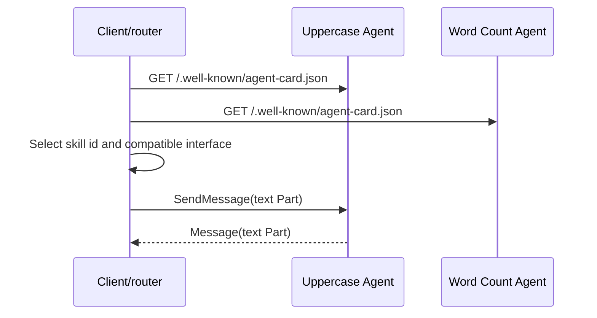

# 01 — Discovery and routing

An A2A client should discover capabilities before it delegates work. This recipe starts two unrelated
agents, fetches their public Agent Cards through `ClientFactory`, indexes their `skills`, and routes a
request to the agent that advertises the requested skill.

Run it with `npm run cookbook -- 01`. Inspect `discoverAgents()` and `routeToSkill()` in `index.js`.
The important boundary is the Agent Card: names are for people, while stable skill IDs, tags, media
modes, capabilities, and `supportedInterfaces` drive machine routing.

Failure behavior is deliberate: an unavailable card means that capability is offline, and an unknown
skill fails before any message is sent. The test verifies both successful routing and the missing-skill
branch.
