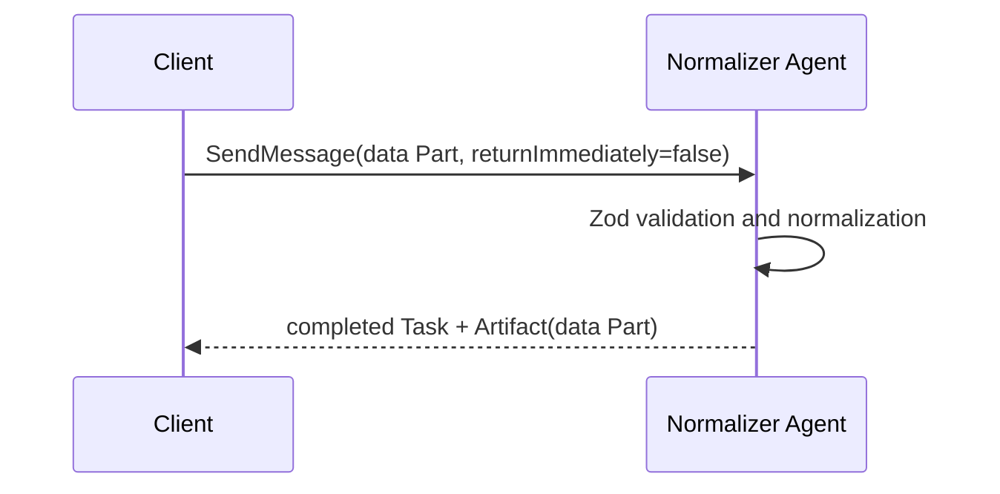

# 02 — Synchronous structured exchange

Use blocking `SendMessage` when the server can finish within the caller's request budget. The client
sends a structured data Part; the server validates it with Zod and returns a completed Task containing
a normalized Artifact.

Run `npm run cookbook -- 02`. `workRequestSchema` is enforced before `AgentExecutor` execution so bad
input becomes the protocol's `RequestMalformedError`, rather than an opaque failed business task.

This recipe also illustrates the response choice: a direct Message is appropriate for a stateless
answer, while a completed Task is useful when the result should remain addressable through task APIs.
The normalizer chooses a Task because its Artifact is a durable output.
