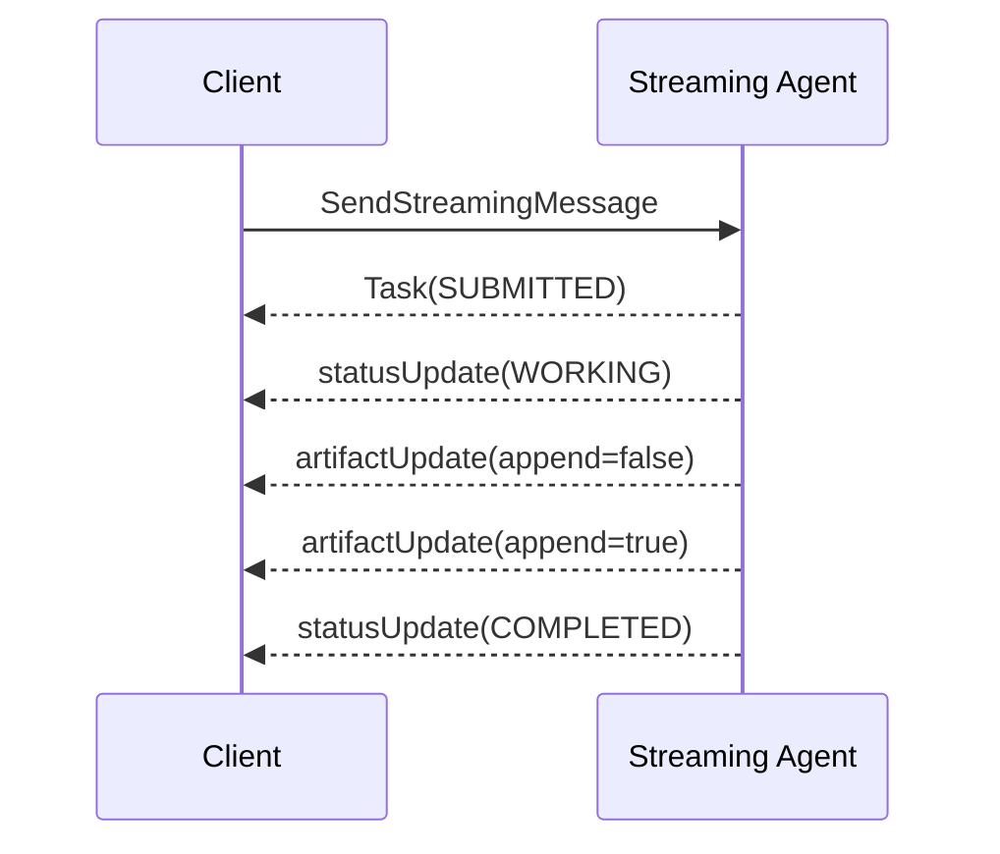

# 03 — Streaming results

`SendStreamingMessage` keeps an SSE connection open while an agent publishes progress and incremental
output. The Agent Card must advertise `capabilities.streaming: true`.

Run `npm run cookbook -- 03`. The client switches on `event.payload.$case`; the wire payload contains
one of `task`, `message`, `statusUpdate`, or `artifactUpdate`.

Chunks reuse one `artifactId`. `append` says whether to concatenate the chunk and `lastChunk` marks the
last artifact chunk. Task completion—not a separate `final` flag—closes the lifecycle stream.
