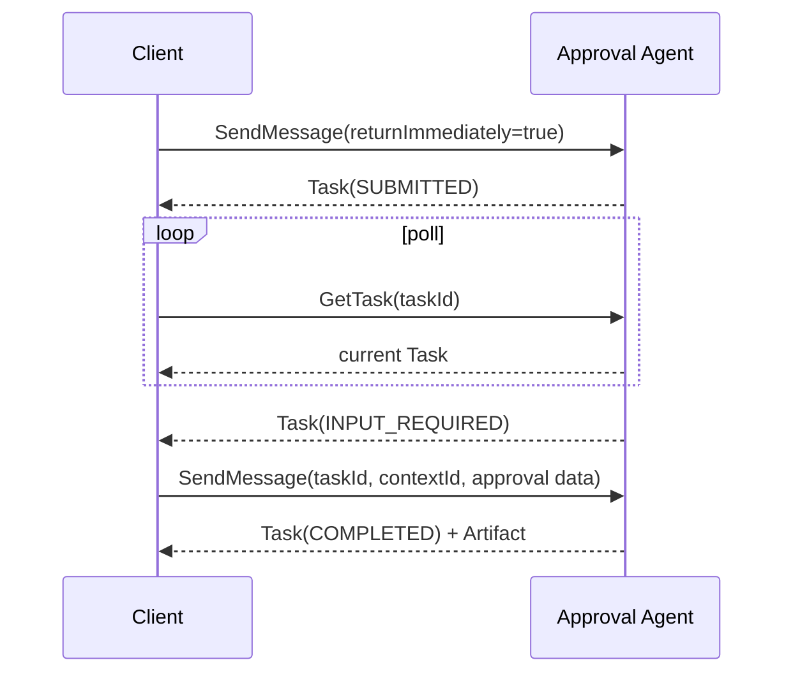

# 04 — Long-running multi-turn task

This recipe submits work with `returnImmediately: true`, polls it with `GetTask`, receives an
`INPUT_REQUIRED` interruption, and sends the missing value on the same active task.

Run `npm run cookbook -- 04`. The follow-up preserves both IDs and adds another Message to task
history. A bad approval demonstrates terminal `REJECTED`; a completed, failed, canceled, or rejected
task cannot receive another turn.
