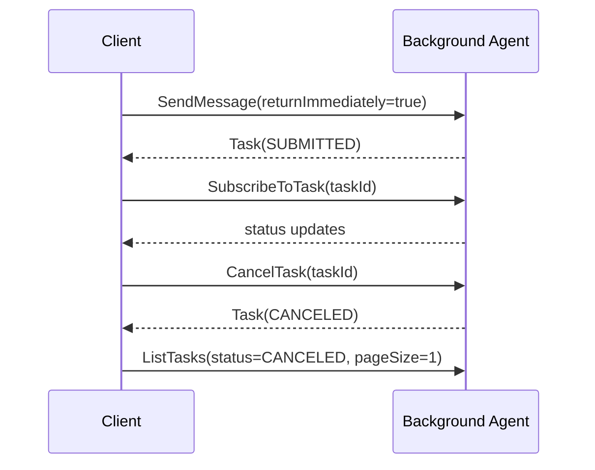

# 05 — Task control and recovery

Polling is not the only way to observe work. `SubscribeToTask` attaches an SSE consumer to an existing
non-terminal task, while `CancelTask` requests cooperative cancellation. `ListTasks` supports filtered,
cursor-paginated operational views.

Run `npm run cookbook -- 05`. Cancellation is cooperative: the executor records the request, checks at
safe yield points, publishes `CANCELED`, and cleans up. Subscriptions are only valid while a task is
non-terminal. The integration test creates two canceled tasks and follows `nextPageToken`.
