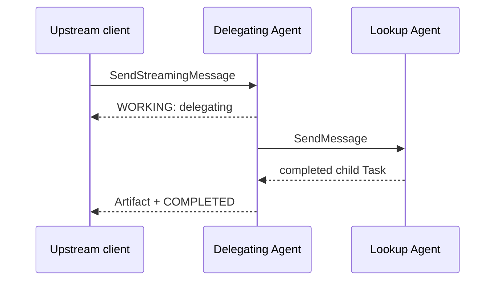

# 06 — Delegating agent

An A2A server can also be an A2A client. The composer streams progress to its caller while discovering
and calling a separate lookup agent synchronously.

Run `npm run cookbook -- 06`. The delegating agent keeps an explicit parent-to-child correlation entry
containing the downstream URL, `contextId`, and `taskId`. The two agents own independent contexts.

If discovery, the downstream call, or its timeout fails, the parent still completes with
`degraded: true` and a visible fallback. A production coordinator may choose failure instead; the key
is to make the policy and provenance explicit.
