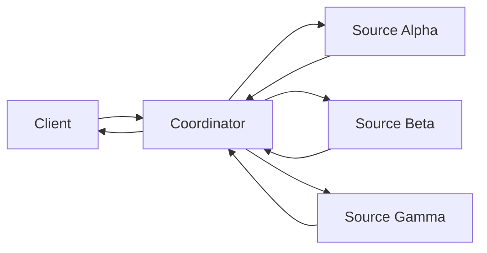

# 07 — Fan-out and aggregation

The coordinator submits child tasks to three independent agents concurrently, waits with
`Promise.allSettled` semantics, and produces one aggregate Artifact.

Run `npm run cookbook -- 07`. One source intentionally fails. The parent completes with available
results, a `missing` list, `degraded: true`, and Artifact metadata that records every successful child
URL, context, and task ID. If all sources fail, the parent fails.

`CancelTask` on the parent calls `CancelTask` for each known child before the parent publishes
`CANCELED`. The test verifies the terminal state at every child, not only at the coordinator.
