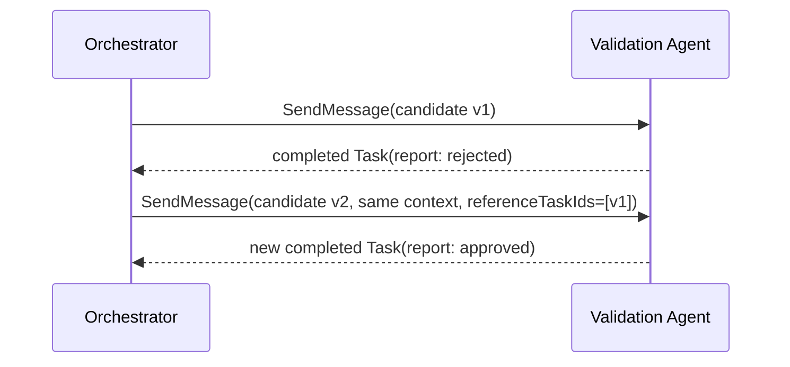

# 08 — Validation and refinement gate

A business rejection is different from an A2A transport failure. The gate successfully completes its
task and returns a validation Artifact whose `verdict` is `approved` or `rejected`. Client code enforces
the gate before presenting the candidate.

Run `npm run cookbook -- 08`. A terminal task is immutable, so remediation creates a new task in the
same context. `referenceTaskIds` lets this server resolve its earlier validation task. Results from
unrelated servers should instead be supplied as Parts with provenance metadata.
