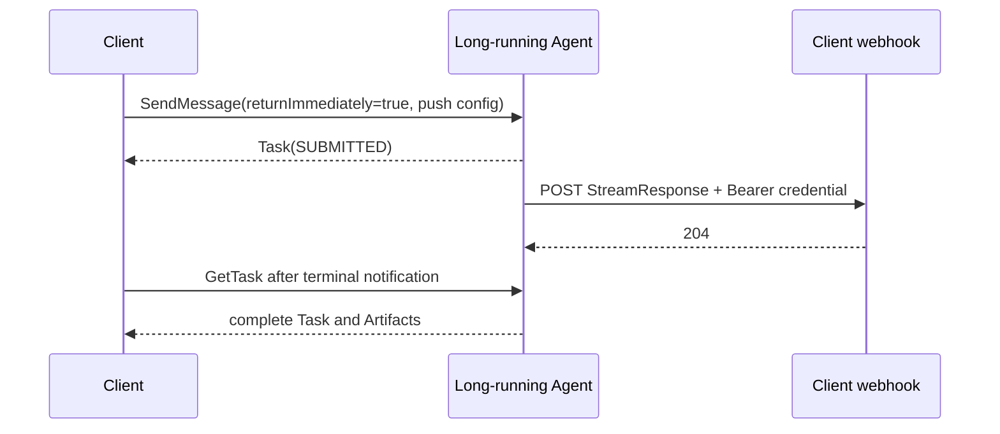

# 09 — Push notifications

Push notifications fit jobs that outlive a persistent client connection. The client supplies a webhook
configuration either with its initial Message or through `CreateTaskPushNotificationConfig` after task
creation.

Run `npm run cookbook -- 09`. The Hapi webhook checks the declared Bearer credential before accepting
the `application/a2a+json` body. The client reconciles each terminal notification with `GetTask`; a
notification is a signal, not a replacement for authoritative task retrieval.

The recipe also demonstrates create/get/list/delete configuration operations and an allowlisted webhook
store. Production senders should require HTTPS, validate ownership, restrict egress to prevent SSRF,
and process duplicate notifications idempotently.
