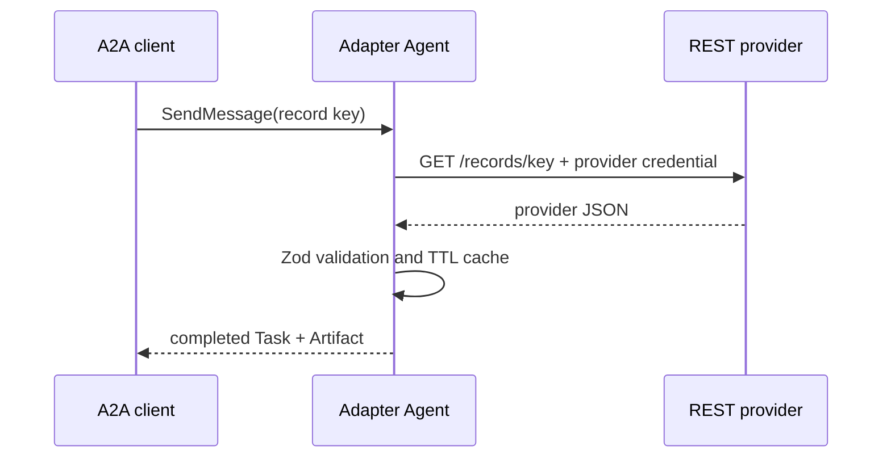

# 10 — External-service adapter

An ordinary REST API can become an A2A skill without exposing provider details upstream. This recipe
runs a local Hapi provider and a separate A2A adapter agent.

Run `npm run cookbook -- 10`. Repeating the same A2A request still creates a new task, but the adapter
serves its business data from cache. Provider credentials remain inside the adapter process.

The mock exposes deterministic 429, 503, and slow paths. The agent maps them to `FAILED` task statuses
with retry metadata instead of leaking raw HTTP responses or retrying blindly.
