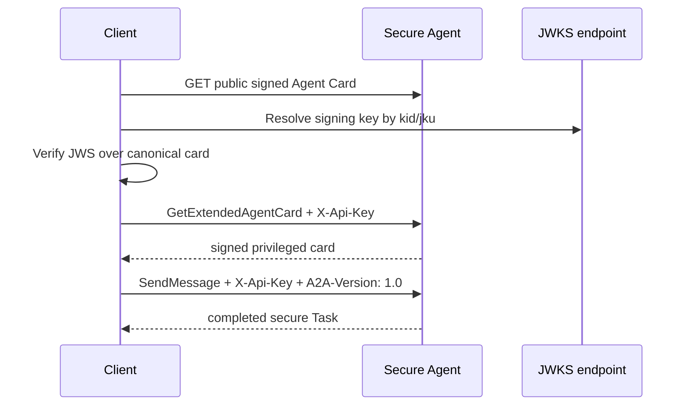

# 11 — Security and trust

The public Agent Card declares an API-key security scheme. Credentials travel in HTTP headers, never in
Message Parts. Authenticated clients can call the skill and retrieve the extended Agent Card.

Run `npm run cookbook -- 11`. The card uses ES256 JWS with RFC 8785 canonicalization through the SDK,
and publishes its public key as JWKS. The demo verifies the card, proves that a changed name invalidates
the signature, and refuses protocol version `9.9`.

The keys and API key are ephemeral teaching fixtures. Production deployments need managed key
rotation, trusted JWKS origins, TLS, real identity, authorization, and secret storage.
